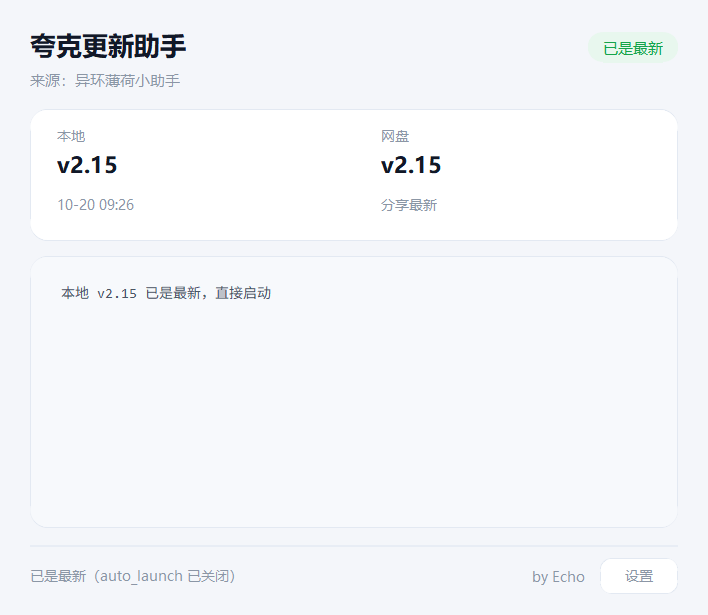

<div align="center">

# 夸克更新助手

一个盯夸克网盘分享的小工具：定时看有没有新版本，有就自动转存、下载、启动。


</div>

---

## ✨ 它做什么

- 🔍 **开箱即用** — 双击就查，有新版自动下载并拉起，没新版直接启动本地最新那份
- 🔐 **不内置账号** — 首次运行弹微信二维码，扫码即用；凭据只存本机，号变了重新扫就行
- 📦 **复用网盘副本** — 同一个版本只转存一次，之后直接取直链（省流量也避开一个坑，见下）
- 🪟 **不留杂物** — 配置、状态、日志全在 `%LOCALAPPDATA%\QuarkUpdateHelper`（隐藏目录）
- 🎨 **暖色界面** — 三行信息：来源 / 本地版本 / 网盘版本，加一条滚动日志



---

## 🚀 用法

1. 把 `夸克更新助手.exe` 放到任意目录（下载文件会落在同一目录）
2. 双击运行
3. 首次启动若没有可用 Cookie，会弹二维码 —— **用微信扫一扫**
4. 之后每次双击都是：查更新 → 有就下 → 启动

> 目标程序如果自己要求管理员权限，UAC 弹窗要点「是」，点「否」会报
> `操作已被用户取消`，那不是助手的锅。

---

## 🧠 摸过的坑（留着别再踩）

### 回收站墓碑：删得越干净，下次越下不动

`/file/delete` 的 `action_type` 无论填 `1` 还是 `2`，**都只是把文件移进回收站**，内容仍在库里。
于是再转存**同名同内容**的文件时，`/share/sharepage/save` 会把**回收站里那个已删 fid** 还给你：

- 拿它 `/file/download` → `404 21001 file not found`
- 拿它 `/file/delete` → `400 23004 文件已经删除`

所以本工具**不删中转副本**，而是留着当缓存：

```python
existing = [f for f in list_dir(s, to_fid) if not f.get("dir")]
hit = _match_existing(existing, g)   # 同名 + 同大小才算命中
if hit: reuse[...] = hit             # 直接取直链
else:   pending.append(g)            # 真没有再转存
```

> `_match_existing()` **必须比大小**。对方出新版可能沿用旧文件名，只按名字匹配会拿到旧文件。

### 扫码：`need_bind_mobile` 是两条不同的路

`open.weixin.qq.com/connect/qrconnect` 带不带 `need_bind_mobile=1`，走的不是同一个分支：

| URL | 分支 | 结果 |
|---|---|---|
| `?need_bind_mobile=1` | `getAuthCode` | 只把 code 透传回页面，实测被 302 打回 |
| 不带该参数 | `authorize` | **正路**，200 直接下发 cookie 或 302 带 `service_ticket` |

拿到 `service_ticket` 后：`GET /account/info?st=<ticket>&lw=scan&fr=pc&platform=pc` 收 Set-Cookie，
缺 `__puus` 时再打一次 `drive-pc.quark.cn/1/clouddrive/auth/pc/flush` 补齐。

### requests 会把「302 拒绝」伪装成「200」

调试这类跳转接口必须 `allow_redirects=False`，否则 `raise_for_status()` 全绿，
`r.json()` 直接抛 `JSONDecodeError`，看起来像服务端返回了坏数据。

### 用到的接口

| 用途 | 端点 | 备注 |
|---|---|---|
| 取分享 token | `/share/sharepage/token` | 匿名可用 |
| 列分享目录 | `/share/sharepage/detail` | 匿名可用 |
| 转存 | `/share/sharepage/save` | 需登录，返回 `task_id` |
| 查任务 | `/task` | `task_id` 必须放 **query** |
| 建目录 | `/file` | 字段是 `file_name` + `dir_path:""` + `dir_init_lock` |
| 取直链 | `/file/download` | POST `{fids}` |
| 恢复回收站 | `/file/recycle/recover` | `{fid_list, select_mode, exclude_fids}`，`select_mode=1` = 全部恢复 |

---

## 🛠 自己构建

```bash
python -m venv venv
venv\Scripts\pip install -r requirements.txt

python build.py     # 产物 dist/QuarkWatcher.exe
```

> **构建产物不含任何账号凭据。** 首次运行会弹二维码，扫码后凭据写进
> `%LOCALAPPDATA%\QuarkUpdateHelper\config.json`，只在本机。
> 早先版本试过把 Cookie 焊进 exe，好处是开箱即用，坏处是号一失效你只会拿到一串
> `401 require login`，还得重新打包才能换号 —— 已经去掉了。

`build.py` 里那段 `dis._get_const_info` 猴补丁是给 CPython 3.10.0 的已知 bug 打的，
不补 PyInstaller 会直接崩，换 3.11+ 可以删掉。

---

## 🔒 安全说明

- 仓库 **不含任何 Cookie**。`config.json` / `state.json` 都被 `.gitignore` 挡住
- 打包产物**不含账号信息**，首次运行必须扫码
- 运行时凭据只存在本机隐藏目录，不上传、不写日志
- 下载直链是带 `auth_key` / `token` 的签名 URL，日志里一律脱敏成 `with url: <path>`

---

<div align="center">

by **Echo**

</div>
