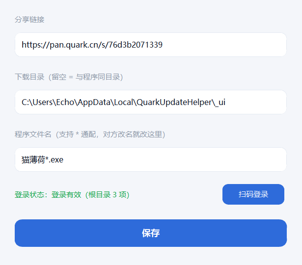

# 技术细节

写给以后要改这个程序的人（很可能是我自己）。README 只讲怎么用，这里讲为什么这么写。

## 目录与文件职责

| 文件 | 职责 |
|---|---|
| `gui.py` | 界面 + 主流程编排（`App.task_start` 一次跑完全部逻辑） |
| `quark_watch.py` | 网盘接口、转存、下载、状态基线、日志 |
| `quark_login.py` | 微信扫码登录全链路 |
| `build.py` | PyInstaller 打包，内含一处 CPython 3.10.0 的猴补丁 |
| `deploy.py` | 把产物复制到桌面并复位本机配置 |
| `app.ico` / `app.png` | 图标（蓝底白云 + 下载箭头） |

运行时数据全部落在 `%LOCALAPPDATA%\QuarkUpdateHelper`（隐藏目录）：

```
config.json   配置（含 cookie）
state.json    上次看到的分享文件基线
logs/         按天滚动日志
待办.txt       仅在有下载失败时出现
```

## 一次启动做了什么

```
读配置 → 匿名拉分享快照 → 挑出最新的 exe（按 launch_pattern 过滤）
   ├─ 本地时间 >= 网盘时间 - 60s  → 已是最新 → 启动本地那份 → 退出
   └─ 否则 → 校验登录 → 没登录就弹码 → 转存/复用 → 下载 → 启动 → 退出
```

判断「是否最新」用的是**修改时间**而不是版本号：对方改名、改版本号都不受影响，留 60 秒容差应对时钟漂移。

## 配置项

| 键 | 说明 |
|---|---|
| `share_url` / `pwd_id` / `passcode` | 分享链接与提取码 |
| `root_fid` | 分享内的子目录 fid，空 = 整个分享 |
| `download_dir` | 空 = 跟随 exe 所在目录（默认） |
| `flat` | 平铺下载，不建标题子目录 |
| `drive_folder` | 网盘中转目录名，默认 `夸克同步` |
| `cookie` | 登录凭据，只在首次扫码后写入 |
| `auto_launch` | 下载/查完后是否自动启动 |
| `launch_pattern` | 文件名通配，默认 `猫薄荷*.exe` |
| `auto_check_hours` | 常驻时每隔几小时复查，0 = 关闭 |
| `proxy` | `auto`（先直连再系统代理）/ `env` / 具体代理 URL |

## 用到的接口

| 用途 | 端点 | 备注 |
|---|---|---|
| 取分享 token | `/share/sharepage/token` | 匿名可用 |
| 列分享目录 | `/share/sharepage/detail` | 匿名可用 |
| 转存 | `/share/sharepage/save` | 需登录，返回 `task_id` |
| 查任务 | `/task` | `task_id` 必须放 **query**，放 body 无效 |
| 建目录 | `/file` | 字段是 `file_name` + `dir_path:""` + `dir_init_lock:false` |
| 取直链 | `/file/download` | POST `{fids}`，逐个取，批量取一个失败会拖垮整批 |
| 删文件 | `/file/delete` | `{action_type:2, filelist, exclude_fids:[]}` |
| 恢复回收站 | `/file/recycle/recover` | `{fid_list, select_mode, exclude_fids}`，`select_mode=1` = 全部恢复 |

> `/file/recycle/delete` 和 `/file/recycle/restore` 都是 404，别浪费时间。

## 坑一：回收站墓碑（最要命的一个）

`/file/delete` 的 `action_type` 填 `1` 还是 `2`，**都只是把文件移进回收站**，内容仍在库里。
于是再转存**同名同内容**的文件时，`/share/sharepage/save` 会把**回收站里那个已删 fid** 还给你：

- 拿它 `/file/download` → `404 21001 file not found`
- 拿它 `/file/delete` → `400 23004 文件已经删除`

**删得越干净，下一次越下不动。** 曾有一个「转存前先删干净同名副本」的函数
（`_purge_dupes`），正是这个死循环的制造者，已整个删除，别再写回来。

现在的策略是**留着当缓存**：

```python
existing = [f for f in list_dir(s, to_fid) if not f.get("dir")]
hit = _match_existing(existing, g)   # 同名 + 同大小才算命中
if hit: reuse[...] = hit             # 直接取直链
else:   pending.append(g)            # 真没有再转存
```

`_match_existing()` **必须比大小**——对方出新版可能沿用旧文件名，只按名字匹配会拿到旧文件。

## 坑二：微信扫码有两条分支

`open.weixin.qq.com/connect/qrconnect` 带不带 `need_bind_mobile=1`，走的不是同一个分支：

| URL | 分支 | 结果 |
|---|---|---|
| `?need_bind_mobile=1` | `getAuthCode` | 只把 code 透传回页面，实测被 302 打回 |
| 不带该参数 | `authorize` | **正路**，200 直接下发 cookie，或 302 带 `service_ticket` |

拿到 `service_ticket` 后：

```
GET /account/info?st=<ticket>&lw=scan&fr=pc&platform=pc   → 收 Set-Cookie
缺 __puus 时再打一次 drive-pc.quark.cn/1/clouddrive/auth/pc/flush
```

二维码内容不是链接本身，而是 `https://open.weixin.qq.com/connect/confirm?uuid=<uuid>`；
长轮询走 `lp.open.weixin.qq.com/connect/l/qrconnect`，靠 `wx_errcode`（408/404/405）和 `wx_code` 判态。

## 坑三：requests 会把「302 拒绝」伪装成「200」

调试这类跳转接口必须 `allow_redirects=False`，否则 `raise_for_status()` 全绿，
`r.json()` 直接抛 `JSONDecodeError`，看起来像服务端返回了坏数据。

## 坑四：日志会把签名直链抄到磁盘上

夸克的下载直链是 `/…?auth_key=…&token=…&ud=…`，**整条就是凭据**。
而 requests 的连接异常会把请求路径原样塞进异常消息：

```
Max retries exceeded with url: /you7O6QO/…?auth_key=…&token=5-a18b30…
```

`log.error(e)` 等于把凭据写进日志文件。注意这里写的是**相对路径**，没有 scheme，
只写 `https?://` 的正则抓不到。`quark_watch._redact()` 叠了两条规则：

```python
_URL_RE     = re.compile(r"https?://[^\s'\"<>)\]，。]+")       # → scheme://host/…
_URLPATH_RE = re.compile(r"(with url:\s*)[^\s'\"<>)\]，。]+")  # → with url: <path>
```

已覆盖全部 9 处异常输出（含写入 `待办.txt` 的那几处）。

## 界面约定

配色跟着 `app.ico` 走：白卡片 + 极浅灰蓝底 + 单一品牌蓝 `#2e6bda`，状态用淡色徽章。



写 customtkinter 时踩到的三个坑：

1. **`CTkFrame` 默认高度 200px**。`pack(fill="x")` 不会自动缩到内容高度，
   版本卡被撑成 200 高把日志和底栏全挤出去了。固定高度的卡片要么显式给 `height=`，
   要么内部用 `place()` 定位。
2. **`place()` 不能传 `width`/`height`**：`ValueError: 'width' and 'height' arguments
   must be passed to the constructor of the widget, not the place method`。
   尺寸要写在构造函数里，`place` 只负责坐标。
3. **底栏要先 pack**。`pack` 按调用顺序分配空间，日志框带 `expand=True` 排在前面时，
   后面的底栏会被挤成 0 高直接看不到。正确顺序：顶部 → 底栏（`side="bottom"`）→ 进度条
   （`side="bottom"`）→ 日志（`fill="both", expand=True`）。

另外 `CTkTextbox` 内层是原生 `tk.Text`，默认贴边，首字会被圆角边框啃掉半个，
需要 `_textbox.configure(padx=12, pady=10)`。

## 构建

```bash
python -m venv venv
venv\Scripts\pip install -r requirements.txt
python build.py          # 产物 dist/QuarkWatcher.exe
python deploy.py         # 复制到桌面并复位本机配置
```

打包参数里 `--collect-all customtkinter` 和 `--collect-submodules qrcode` 都不能省，
否则运行时会找不到主题 JSON 和二维码插件。

`build.py` 开头那段 `dis._get_const_info` 猴补丁是给 **CPython 3.10.0** 的已知 bug 打的，
不补 PyInstaller 直接崩；换 3.11+ 可以删掉。

## 安全

- 打包产物**不含任何账号信息**，首次运行必须扫码
- cookie 只写在本机 `%LOCALAPPDATA%`，不进仓库、不进日志
- 下载直链在日志里一律脱敏成 `with url: <path>`
- `config.json` / `state.json` 都在 `.gitignore` 里
